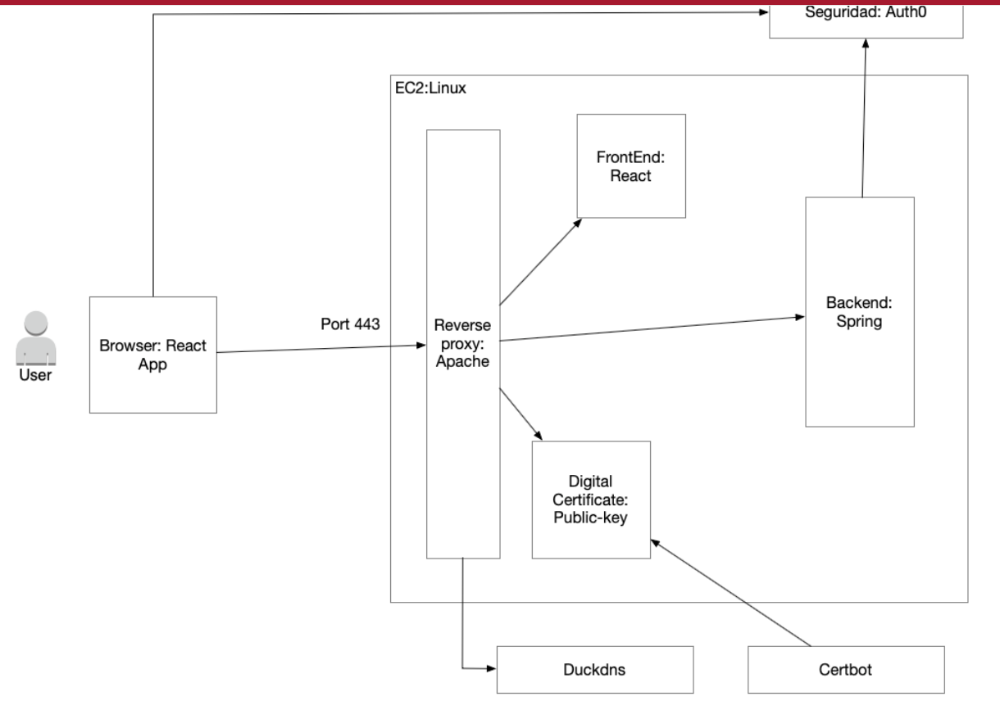

# Secure Web System as an Enterprise Risk Control

A small web system built and deployed as an enterprise risk control. A React single-page application signs users in with **Auth0**. It calls a **Spring Boot** API protected as an OAuth 2.0 Resource Server. The system is published over **HTTPS** through **Apache HTTP Server**, with a **Let's Encrypt** certificate and a **Duck DNS** hostname, on an **AWS EC2** instance.

**Deployed URL:** https://sebas-risk-lab.duckdns.org

**Author:** Sebastian Albarracin Silva

## Architecture

1. The browser signs in through Auth0 and receives a JWT access token for the audience `https://enterprise-risk-api`.
2. The React application sends the token to the API in the `Authorization: Bearer <token>` header.
3. The only public entry point is Apache, on ports 80 and 443. It serves the React build and forwards `/api/` to Spring Boot on `127.0.0.1:8080`. Requests on port 80 are redirected to HTTPS.
4. Spring Boot checks the token's signature against the Auth0 JWKS, its issuer and its audience before it answers.
5. Duck DNS maps `sebas-risk-lab.duckdns.org` to the EC2 public IP. Certbot issues the TLS certificate and renews it automatically.

## Technologies

| Layer | Technology |
|-------|------------|
| Identity provider | Auth0 (tenant `dev-kf4ghetx40fgzuc6.us.auth0.com`) |
| Frontend | React 19, Vite, `@auth0/auth0-react` |
| Backend | Spring Boot 3.5, Spring Web, Spring Security, OAuth2 Resource Server, Actuator |
| Server | AWS EC2 `t3.micro`, Ubuntu 26.04 LTS, OpenJDK 21 |
| Web server and TLS | Apache 2.4, Certbot 4, Let's Encrypt |
| DNS | Duck DNS |

## Repository layout

| Path | Content |
|------|---------|
| `backend/` | Spring Boot API: `GET /api/risk-status` (protected) and `GET /actuator/health` (public) |
| `frontend/` | React SPA with Auth0 login and the call to the protected endpoint |
| `deploy/` | systemd unit, Apache virtual host and Duck DNS update script template used on the server |
| `docs/` | Architecture diagram, evidence screenshots and command output |

## Implementation

### Auth0 configuration

- **API `Enterprise Risk Lab API`:** identifier (audience) `https://enterprise-risk-api`, signed with RS256.
- **Permission `read:risk`:** "Read the protected risk status".
- **Single Page Application `Enterprise Risk Lab Frontend`:** the allowed callback URLs, logout URLs and web origins are limited to `http://localhost:5173` and `https://sebas-risk-lab.duckdns.org`. No wildcards are used.
- **Access to the API:** the SPA was granted **User-Delegated Access** to the API with the `read:risk` permission, because it acts on behalf of a signed-in user. Client (machine-to-machine) access was not granted.
- **Test user:** a database user (`Username-Password-Authentication`) was created to sign in.
- **No client secret:** the browser application only uses the domain, the client ID and the audience.

### Backend (Spring Boot)

- `SecurityConfig` sets up a stateless resource server:
  - `/actuator/health` is public.
  - `/api/**` requires an authenticated JWT.
  - Every other path is denied.
- **JWT validation:** `issuer-uri` points to `https://dev-kf4ghetx40fgzuc6.us.auth0.com/`. `audiences` is set to `https://enterprise-risk-api`, so tokens issued for any other API are rejected.
- **CORS:** only the exact origins `http://localhost:5173` and `https://sebas-risk-lab.duckdns.org` are allowed, with method `GET` and headers `Authorization` and `Content-Type`. The origins can be overridden with `APP_CORS_ALLOWED_ORIGINS`.
- **Protected endpoint:** `RiskController` exposes `GET /api/risk-status`. It returns the protection status, the token subject and the control applied.
- **Tests:** `RiskControllerTest` (MockMvc) covers these cases:
  - `401` without a token.
  - `200` with a valid JWT.
  - Public health check.
  - `403` on any other path.

### Frontend (React)

- `Auth0Provider` is configured with the domain, the client ID and the audience. These values come from Vite environment variables. The local `.env` files are not committed.
- `App.jsx` handles login and logout. It gets the access token with `getAccessTokenSilently()` and calls `/api/risk-status` with the Bearer header. It shows either the JSON response or the HTTP status of a failed request.
- **Separate API URLs:** the local build calls `http://localhost:8080`. The production build calls `https://sebas-risk-lab.duckdns.org`.

## Local testing

The full flow was first tested on my machine:

| Test | Result |
|------|--------|
| `mvnw test` (4 tests) | All passed |
| `npm run build` | Build succeeded |
| `GET http://localhost:8080/actuator/health` | `{"status":"UP"}` |
| `GET http://localhost:8080/api/risk-status` without a token | `401 Unauthorized` |
| Login at `http://localhost:5173` with the Auth0 test user, then **Call protected API** | `200` with `"status": "protected"` and the user's `subject` |

## Deployment on AWS

### Server and network

- **Instance:** EC2 `t3.micro`, Ubuntu 26.04 LTS, region `us-east-1`. Access is SSH-key only. Password login and root login are disabled.
- **EC2 security group:**
  - Inbound SSH (22).
  - HTTP (80), needed for the Let's Encrypt challenge and the HTTPS redirect.
  - HTTPS (443).
  - Port 8080 is **not** opened.
- **Host firewall:** `ufw` is enabled with a default deny policy for incoming traffic. It allows only `OpenSSH` and `Apache Full` (80/443).
- **Operating system:** fully updated with `apt upgrade` before deployment.
- **Duck DNS:** the subdomain `sebas-risk-lab.duckdns.org` points to the instance's public IP (`54.227.130.118`). The Duck DNS token is kept only on the server, never in the repository.

### Accounts (least privilege)

| Account | Purpose |
|---------|---------|
| `deploy` | Non-root deployment user without sudo, used to upload the build artifacts over SCP |
| `riskapi` | System account with no login shell and no home directory that runs the API |
| `ubuntu` | Administrative account used for installation |

### Backend service

- The JAR was built locally with `mvnw clean package` and installed as `/opt/enterprise-risk-api/app.jar`, owned by `riskapi`.
- It runs under systemd as `enterprise-risk-api.service` (see `deploy/enterprise-risk-api.service`). The service sets these values through environment variables:
  - issuer
  - audience
  - CORS origin
  - `SERVER_ADDRESS=127.0.0.1`
- Because of that last setting, the API listens **only on the loopback interface**.
- Logs are centralized in journald (`journalctl -u enterprise-risk-api`).

### Apache and HTTPS

- The production React build is served from `/var/www/enterprise-risk-frontend`. Directory listing is disabled, and a rewrite to `index.html` handles SPA routes.
- Enabled modules: `ssl`, `proxy`, `proxy_http`, `rewrite` and `headers`.
- `/api/` is reverse-proxied to `http://127.0.0.1:8080/api/`. The default site was disabled.
- `certbot --apache` obtained the certificate for `sebas-risk-lab.duckdns.org` and created the HTTPS virtual host.
  - A vhost-level `RewriteEngine On` was added so that HTTP requests are redirected permanently (`301`) to HTTPS.
  - On the HTTPS virtual host, the `X-Forwarded-Proto` header is set to `https`.
- Automatic renewal runs through the `certbot.timer` systemd timer, and `certbot renew --dry-run` was verified.

## Verification results

| Check | How it was verified | Result |
|-------|---------------------|--------|
| Unauthenticated requests return 401 | `curl -i https://sebas-risk-lab.duckdns.org/api/risk-status` | `401` with `WWW-Authenticate: Bearer` |
| A logged-in user can call the API | Login and **Call protected API** in the deployed site | `200` with `"status": "protected"` |
| The backend validates issuer and audience | `issuer-uri` and `audiences` configuration, plus 401 for requests without a valid token | Done |
| The application is available over HTTPS | `https://sebas-risk-lab.duckdns.org` | `200`; HTTP answers `301` to HTTPS |
| Valid certificate | `openssl s_client` and the browser certificate viewer | Issued by Let's Encrypt, valid until 19 Jan 2027, `Verify return code: 0 (ok)` |
| Port 8080 not public | `curl http://54.227.130.118:8080/` from the internet | Connection timed out; the API listens on `127.0.0.1:8080` only |
| Certificate renewal | `sudo certbot renew --dry-run` | All simulated renewals succeeded |

The full command output is in [docs/certificate.txt](docs/certificate.txt).

## Risk-control reflection

| Control | Risk reduced | Evidence |
|---------|--------------|----------|
| Auth0 authentication | Impersonation and weak credential handling | Auth0 login flow and user identity |
| JWT validation at the API | Unauthorized API access | 401 without a valid token |
| Audience validation | Token reuse against another API | The API accepts only tokens for `https://enterprise-risk-api` |
| HTTPS with a valid certificate | Credential or token exposure in transit | Browser certificate details and `openssl` output |
| Apache reverse proxy | Direct exposure of the application port | Only ports 80 and 443 are public; the API is bound to 127.0.0.1 |
| Central service logs | Delayed incident investigation | `journalctl -u enterprise-risk-api` output |

**Authentication vs. authorization:**
- **Authentication** proves *who* the user is. Auth0 verifies the user's credentials and issues a signed token for that identity.
- **Authorization** decides *what* that identity is allowed to do. The API accepts a request only if the token is validly signed by our tenant, carries our issuer and is intended for our audience. Otherwise it answers 401, and any path outside `/api/**` is denied.

**Security practices applied:**
- No secrets are committed: no `.env` files, Auth0 secrets, Duck DNS token or server keys.
- The SPA uses only the Auth0 client ID.
- CORS is limited to the exact development and production origins.
- Access tokens are never displayed, logged or stored manually.
- The service runs under a dedicated low-privilege account.
- The operating system was updated before exposure.

## Evidence

### Local authenticated API call

### Deployed authenticated API call

